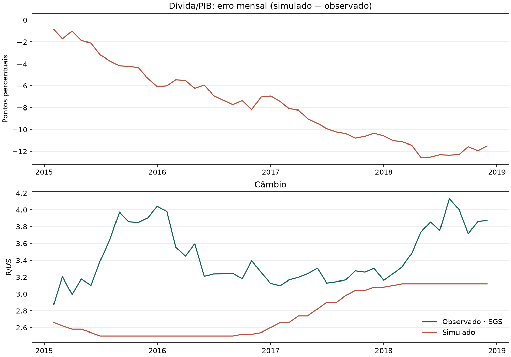

# Diagnóstico histórico e auditoria contábil

## Escopo

Exercício condicional de 02/2015 a 12/2018, com 47 meses e 100,000 agentes sintéticos. O mês anterior inicializa o modelo com dívida/PIB de 57.16%. A Selic futura realizada é usada como entrada; não é uma previsão em tempo real nem um teste fora da amostra. Dados do SGS podem ter sido revisados e datas de divulgação não foram verificadas.

## Erros históricos

| Indicador | Simulado final | Observado final | Viés médio | Erro absoluto médio | RMSE |
| --- | ---: | ---: | ---: | ---: | ---: |
| Dívida/PIB (p.p. para erros) | 63.78% | 75.27% | -7.76 | 7.76 | 8.48 |
| Câmbio (R$/US$) | 3.1223 | 3.8748 | -0.6867 | 0.6867 | — |

O erro é simulado menos observado. Inflação anualizada instantânea simulada (7.57% no último mês) e IPCA observado acumulado em 12 meses (3.75%) não são a mesma medida; não são usados aqui para calcular erros de previsão.

## Decomposição da dívida simulada

Contribuições acumuladas para a variação da dívida/PIB, em pontos percentuais, segundo a identidade do próprio modelo:

| Componente | p.p. |
| --- | ---: |
| Juros | +27.785 |
| Resultado primário (superávit reduz a dívida) | -0.884 |
| Variação do PIB nominal no denominador | -20.283 |
| Residual numérico | +0.000003 |
| Variação total simulada | +6.618 |

A decomposição usa o PIB nominal corrente para juros e resultado primário e o estoque anterior para o efeito do denominador. Ela explica a trajetória **simulada**, não decompõe a dívida observada nem identifica as causas do erro.

## Auditoria de fluxos e estoques

Unidades abaixo são nominais, na escala em que o PIB inicial é 100; fluxos anualizados são divididos por 12 antes de acumular. Não são valores em reais nem parcelas constantes do PIB.

- Ajuste acumulado pelo piso zero da riqueza: +0.0000.
- Ajuste acumulado pela normalização da riqueza à dívida: -151.6727. Esse ajuste altera a riqueza além da poupança calculada; igualar estoques não prova consistência fluxo-estoque.
- Arrecadação pública acumulada sem contrapartida nos impostos de famílias explicitamente modelados: +1.0560. A arrecadação de base é calculada sobre o PIB nominal corrente, enquanto o imposto explícito das famílias incide sobre a renda do trabalho do período anterior.
- Diferença absoluta acumulada entre juros pagos pelo governo e recebidos pelas famílias: 0.000002; pequenas diferenças refletem a regularização numérica usada no denominador.
- O gasto primário total não é distribuído integralmente como renda ou transferência às famílias no modelo; tampouco há balanços explícitos de empresas, setor externo e banco central. A revisão de isenções eleva a receita pública sem débito correspondente nas famílias. Por isso, não é possível demonstrar fechamento setorial completo.

## Interpretação e próximos passos

Os dados não demonstram que uma política específica causou o desvio. Antes de estimar elasticidades ou comparar com o Focus, é necessário definir as contrapartidas setoriais, corrigir os fluxos sem impor igualdade artificial de estoques e validar as identidades com testes. Depois, incorporar microdados e séries fiscais com suas datas de divulgação, e separar calibração e avaliação fora da amostra. A PMC não é identificada simplesmente a partir do consumo observado.

Reprodução: `python -m src.relatorio.diagnostico --dados data/sgs --agentes 100000 --saida data/sgs`.
